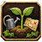

# Farming Helper



**Quest Helper for your farm runs!**

A RuneLite plugin that guides you through farming runs, recommends supplies from your available stock, and highlights what to do at each patch. Designed with Ironmen in mind, but useful for any account.

## Getting started

1. Install **Farming Helper** from the [RuneLite Plugin Hub](https://runelite.net/plugin-hub/show/farming-helper).
2. Open your bank and, if unlocked, the Farming Guild Seed Vault. This lets the helper remember your supplies.
3. Click the Farming Helper icon in the RuneLite sidebar and select a grouped, individual or manual run.
4. Gather your supplies, start the run and follow the highlighted patches and instructions.

Open your bank and Seed Vault regularly to keep recommendations accurate. You can start or continue a run even with missing supplies.

## Features

- **Farming runs:** combined tree, crop, hops & bush, specialty, individual and custom patch selections, including compost and birdhouses.
- **Smart crop selection:** recommends crops using your Farming level, observed stock and preferred seed order. Customize individual patches or let the helper choose for you.
- **Step-by-step guidance:** harvest, clear, compost, plant, water, check health and protect crops as appropriate. Known growing or inaccessible patches are omitted from the active itinerary.
- **Supply checklist:** live carried quantities for seeds, saplings, compost, payments and tools. Includes sapling preparation and optional travel recommendations.
- **Bank and Seed Vault:** optional farming-focused storage views and item highlights to make gathering supplies easier.
- **Crop preferences:** choose which patches to visit, which crops to preserve, how to prepare and whether to pay gardeners. Preferences are saved per character.

All gameplay actions are performed by the player.

## Other plugins

Farming Helper works independently. The following RuneLite plugins complement it:

- [Shortest Path](https://runelite.net/plugin-hub/show/shortest-path) — optional navigation to the next patch or preparation destination. Configure available travel methods in Shortest Path.
- **Bank Tags** — provides the native farming bank view when enabled.
- **Time Tracking** — supplies recorded patch states and timers where available.

Quest Helper does not need to be installed.

## Versions and feedback

This repository documents the current development version (**v0.50**). The Plugin Hub version may be older until its next update is reviewed and merged.

See the [changelog](CHANGELOG.md) for changes. When reporting a problem, include the plugin version, run type, affected location and steps to reproduce it. Screenshots of the guide can help; remove account details first.

## Credits

Farming Helper is a standalone project built on existing open-source work. Thanks to:

- [Farming Patch Advisor](https://github.com/Seadeadmeat/farming-patch-advisor) by Seadeadmeat — original farming catalogs, crop recommendations and patch highlighting foundations.
- [Quest Helper](https://github.com/Zoinkwiz/quest-helper) by Zoinkwiz and contributors — farming registry, conditional steps, exact patch targets and sidebar inspiration.
- [RuneLite](https://github.com/runelite/runelite) contributors, including Abex and NotFoxtrot — farming state decoding and Bank Tags foundations.
- [Shortest Path](https://github.com/Skretzo/shortest-path) contributors — optional navigation integration and licensed transportation data.
- [Farm Run Autopilot](https://github.com/elzerma/farm-run-autopilot) contributors — adapted route-ordering techniques.
- [Birdhouse overlay](https://github.com/hong-niu/runelite-birdhouse-overlay) and RuneLite Time Tracking contributors — birdhouse state and object data.

Developed and maintained by FrederickCampbell with AI assistance. Upstream copyright notices and licenses are retained.

## Development

Use JDK 21; the plugin targets Java 11.

```bash
./gradlew clean test build
./gradlew run
```

On Windows, use `gradlew.bat`. For Jagex-account login in a development client, see RuneLite's [Using Jagex Accounts](https://github.com/runelite/runelite/wiki/Using-Jagex-Accounts) guide.

[Technical notes](docs/IMPLEMENTATION.md) · [Plugin Hub review notes](PLUGIN_HUB_REVIEW.md)

## License

BSD 2-Clause. See [LICENSE](LICENSE) and the accompanying upstream license files: [Quest Helper](LICENSE-QUEST-HELPER), [Bank Tags](LICENSE-BANK-TAGS), [Shortest Path](LICENSE-SHORTEST-PATH), [Farm Run Autopilot](LICENSE-FARM-RUN-AUTOPILOT) and [Birdhouse](LICENSE-BIRDHOUSE).

Happy farming!
